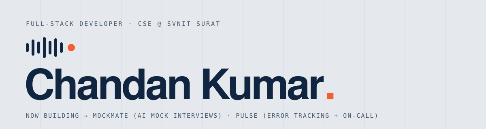

<picture>
  <source media="(prefers-color-scheme: dark)" srcset="assets/banner-dark.svg" />
  
</picture>

I'm Chandan, a Computer Science student at **SVNIT Surat** (2024–28). I build full-stack products end to end — and the
part I enjoy most is the backend that keeps them correct when things go wrong: job queues, idempotent payments,
race-safe credits, retries and on-call alerts.

## Now building

<table>
  <tr>
    <td width="50%" valign="top">
      
      <h3><a href="https://github.com/chandandev6/MockMate">MockMate</a></h3>
      AI mock interviews, out loud. An AI interviewer asks five questions from your role and resume, listens to
      your spoken answers and scores each one on four criteria — with a report and PDF at the end.
        
      <b>React · Express · MongoDB · Redis/BullMQ · Groq</b> 
      83 tests in CI · race-safe credits + Razorpay · voice in every browser  
      <a href="https://ai-interview-agent-roan.vercel.app">Live demo →</a>
    </td>
    <td width="50%" valign="top">
      
      <h3><a href="https://github.com/chandandev6/Pulse">Pulse</a></h3>
      Self-hosted error tracking with on-call paging. Catches every crash, folds duplicates into one issue and
      wakes whoever is on call — then the next person if nobody answers.
        
      <b>TypeScript · Fastify · PostgreSQL · Redis/BullMQ · React</b> 
      SDK for Node + browser · on-call schedules · escalation policies  
      <a href="https://pulse-log.app">Live demo →</a>
    </td>
  </tr>
</table>

## More projects

| Project | What it is | Stack |
| --- | --- | --- |
| [Chat-app](https://github.com/chandandev6/Chat-app) | Real-time one-to-one chat with online presence | React, Zustand, Socket.io, Express, MongoDB |
| [Hostel complaints API](https://github.com/chandandev6/oops_project) | Students raise complaints, admins assign workers and track status | Express, MongoDB, JWT, Joi |
| [Shop management](https://github.com/chandandev6/shop_management) | Products, customers and bills with automatic stock updates | Express, MySQL, Bootstrap |
| [Backend auth starter](https://github.com/chandandev6/Backend_dev) | Register/login with JWT and email verification | Express, MongoDB, Nodemailer |
| [Game Hub](https://github.com/chandandev6/Miniproject) | Snake and Rock-Paper-Scissors in the browser | Vanilla JS |

**Team projects** — [MindSettler](https://github.com/AkashAero1/GWOC_GlacierNova) (mental-wellness platform, Next.js +
PostgreSQL + LangChain) · [Drishti](https://github.com/PRIYANSHsvnit/Intelligent_Descriptive_Search_System_for_CCTV)
(descriptive search over CCTV footage, Python + FastAPI + PostgreSQL)

## Toolbox

## Problem solving

200+ DSA problems across LeetCode and Codeforces, with regular contests.

